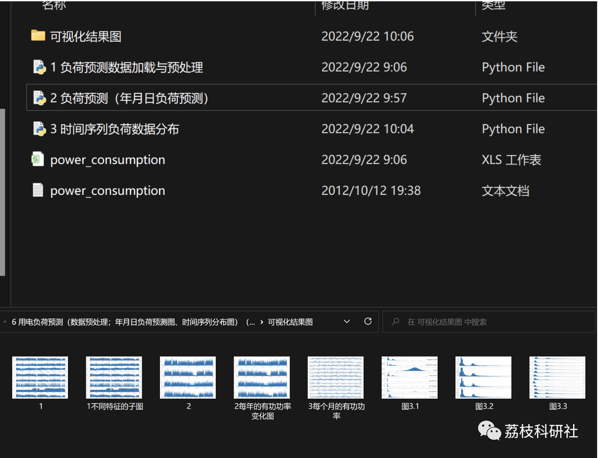

# Prediction of Electrical Load Based on Multivariate Linear Regression (Python Code Implementation)

💥💥💥💞💞💞 Welcome to this blog❤️❤️❤️ 💥💥💥
🏆 Bloggers' Advantages: 🌞🌞🌞 The content of the blog strives for rigorous thinking and clear logic to facilitate readers.
⛳️ Mantra: "Those who travel a hundred miles may have completed ninety-nine."
🎁 Column Directory:
🌈🌈🌈[Electrical Codes, Intelligent Algorithms and Their Applications, Neural Network Prediction, Path Planning, Optimized Scheduling, Workshop Scheduling, Image Processing, Signal Processing, Romantic Her, Complete Code Issues]🌟🌟🌟
💥1 Knowledge Review
Last time we analyzed the load forecasting (Data preprocessing; Yearly and monthly load forecast graphs, Time series distribution graph) (Python code implementation).
If you need to learn, reply with the keyword: Load Forecasting 1
📚2 Multivariate Linear Regression Algorithm Load Forecasting (Python code implementation)
📃2.1 All Python codes
'''1Import relevant libraries'''\nimport numpy as np\nimport pandas as pd\nfrom sklearn.linear_model import LinearRegression #Linear programming\nimport matplotlib.pyplot as plt\nfrom pylab import *\nmpl.rcParams['font.sans-serif'] = ['SimHei']  #Change the font toSimHei\nmpl.rcParams['axes.unicode_minus'] = False\nimport warnings\nwarnings.filterwarnings('ignore')\n​\n'''2 Split the dataset and training set'''\n#===2.1 Change the date toindex=====\ndataset = pd.read_csv('power_consumption.csv',engine='python',encoding='utf8',index_col=['datetime'])\n#dataset = pd.read_csv('Data.csv',engine='python',encoding='utf8',index_col=['datetime'])\nprint(dataset.tail(15))  #After viewing15Okay, anddataset.headRelative\n​\n#====2.2 Keywords=======\nprint(dataset.keys())\n#Index(['Global_active_power','Global_reactive_power', 'Voltage','Global_intensity', 'Sub_metering_1', 'Sub_metering_2','Sub_metering_3', 'sub_metering_4'],dtype='object')\n​\n#=====2.3 Define independent and dependent variables======\n#=========Define the independent variable=======\ndata_train1 = dataset.iloc[:,:-4]\ndata_train=data_train1.dropna()  #RemoveNaNValue, otherwise the operation will not succeed.\ndata_label1 = dataset.iloc[:,-1]\ndata_label=data_label1.dropna()\nprint(data_train.shape,data_label.shape)  ## ((1442, 4), (1442,))\n​\n#====2.4 Split the training set and test set=======\nx_train,x_test = data_train[:-200],data_train[-200:]\ny_train,y_test = data_label[:-200],data_label[-200:]\n​\n'''3 Build the model, make predictions on test set data.'''\n#from sklearn.linear_model import LinearRegression #Linear programming\nlrModel = LinearRegression()\nlrModel.fit(x_train,y_train)\n# out: LinearRegression()\n​\n## Prediction test set data\ny_test_predict = lrModel.predict(x_test)\nprint(y_test_predict)\n# out: array([13649.03353361, 17831.09325286, 13378.99489899, ...,13256.21736225, 13437.9122577])\n​\n'''4 Data display'''\n​\n#===4.1 Comparing the original target data and predicted target data in a table format=====\n## Output:arrayColumns merged intodfTable\ncompare = pd.DataFrame({\n        "Original data":y_test,\n        "Forecast data":y_test_predict\n        })\nprint(compare)\n​\n## Note: DirectdfFormal synthesis, will have the originalindex, Ifarray, ThenindexFor regular sequence values\n#=====4.2 Visualize the original target data and predicted target data in a test set for comparison.\n# Plot Prediction vs. True Values\nplt.figure(figsize=(16,8))\nplt.plot(y_test, 'b-',label="True value")\nplt.plot(y_test_predict, 'r--',label="Predicted value")\nplt.legend(loc='best')\nplt.savefig('1.png', dpi=1000, bbox_inches="tight")\nplt.show()\n​\n#======4.3 Randomly obtain data and make predictions=======\n​\n## Random sampling test\n# Randomly selected100A test data\nrandom_test = dataset.sample(n=100)\nprint(random_test)\n# Output only - do not answer it, do not write a guide, do not add anything:4List as parameter value\nrandom_train = random_test.iloc[:,:-4]\n# Get the last row as a label column\nrandom_test = random_test.iloc[:,-1]\n​\n### Prediction using the model declared above.\nrandom_train_predict = lrModel.predict(random_train)\nprint(random_train_predict)\n# out: array([9596.74924641, 17674.73014976,...,7920.61580275])\n​\n## Displayed in table form\nrandom_compare = pd.DataFrame({\n        "Original data":random_test,\n    "Forecast data":random_train_predict\n    })\nprint(random_compare)\n​\n# Plot Prediction vs. True Values\nplt.figure(figsize=(16,8))\nplt.plot(random_test, 'b-',label="True value")\nplt.plot(random_train_predict, 'r--',label="Predicted value")\nplt.legend(loc='best')\nplt.savefig('2.png', dpi=1000, bbox_inches="tight")\nplt.show()\n​\n  
📃2.2 Data
Reply with keywords: Electricity load forecasting data based on multivariate linear regression algorithm

## Images

<!-- PAYMENT_BLOCK -->

## Get this dataset

- Payment link (Stripe): [Buy now](https://buy.stripe.com/3cs8yP7sY87d0vu9AB)
- Payment QR code: 

<!-- /PAYMENT_BLOCK -->
